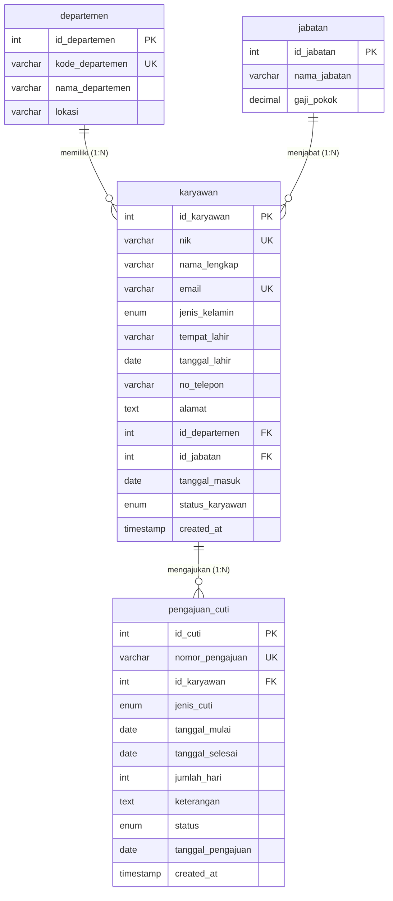

# SIMPEG - Sistem Informasi Manajemen Kepegawaian & Pengajuan Cuti

Aplikasi web manajemen data kepegawaian dan transaksi pengajuan cuti berbasis **PHP 5.6** dan **MySQL/MariaDB**, dirancang dengan arsitektur relasional yang rapi, aman dari ancaman **SQL Injection**, serta memiliki antarmuka modern dan responsif berbasis **Bootstrap 5.3**.

---

## 🚀 Fitur Utama Aplikasi

### 1. Modul Manajemen Karyawan (CRUD Lengkap)
* **Tampil Data (`index.php`)**: Menampilkan seluruh data karyawan dalam tabel HTML yang dihubungkan dengan relasi **JOIN** ke tabel pendukung (`departemen` dan `jabatan`), sehingga nama departemen dan nama jabatan yang ditampilkan (bukan ID mentah).
* **Tambah Data (`tambah.php`)**: Formulir tambah karyawan dengan pilihan departemen dan jabatan yang diambil secara dinamis dari tabel master database.
* **Ubah Data (`edit.php`)**: Formulir pengubahan data karyawan berdasarkan ID terpilih dengan mempertahankan data sebelumnya.
* **Hapus Data (`hapus.php`)**: Menghapus data karyawan dengan konfirmasi dialog JavaScript (`confirm`) untuk mencegah penghapusan yang tidak disengaja.

### 2. Validasi & Keamanan Ketat
* **Proteksi SQL Injection**: Seluruh input teks disanitasi menggunakan `mysql_real_escape_string()` melalui fungsi pembungkus `escape()`, serta tipe data ID di-cast secara ketat menggunakan `(int)`.
* **Proteksi XSS**: Seluruh output data disanitasi dengan `htmlspecialchars()` melalui fungsi `clean()`.
* **Semua Field Wajib Diisi**: Pengecekan kelengkapan data di sisi server sebelum query dijalankan.
* **Integritas Data Unik**: NIK (Nomor Induk Karyawan) dan Email dijamin tidak boleh dobel/duplikat di dalam database.
* **Validasi Format Angka & Tanggal**:
  * Format email diverifikasi dengan `filter_var(..., FILTER_VALIDATE_EMAIL)`.
  * Format nomor telepon diverifikasi dengan pola regex numerik 10–18 digit.
  * Format tanggal diverifikasi sesuai standar `YYYY-MM-DD`.
  * Validasi logika bisnis: Usia minimal karyawan 17 tahun, serta tanggal masuk kerja tidak boleh sebelum tanggal lahir.

### 3. Modul Transaksi: Pengajuan Cuti Karyawan
* **Formulir Transaksi (`tambah_cuti.php`)**: Input permohonan cuti baru dengan data karyawan utama dipilih langsung dari dropdown database (menampilkan NIK, Nama, dan Departemen). Dilengkapi kalkulasi otomatis durasi hari.
* **Daftar Transaksi (`cuti.php`)**: Menampilkan data cuti dengan query **JOIN 4 tabel** (`pengajuan_cuti`, `karyawan`, `departemen`, dan `jabatan`).
* **Filter Rentang Tanggal**: Memfilter riwayat cuti berdasarkan rentang tanggal mulai s/d tanggal selesai atau berdasarkan status permohonan.
* **Rekapitulasi / Total Nilai**: Menampilkan widget ringkasan total transaksi, akumulasi durasi hari cuti, serta rekap status (Disetujui, Menunggu Review, Ditolak), dan baris footer total di bawah tabel.
* **Kelola Transaksi (`edit_cuti.php` & `hapus_cuti.php`)**: Mendukung pengubahan status persetujuan cuti dan penghapusan transaksi dengan konfirmasi.

### 4. Nilai Tambah (Nilai Plus)
* **Pencarian Realtime**: Pencarian data karyawan berdasarkan NIK, Nama, atau Email.
* **Filter Ganda**: Filter karyawan berdasarkan Departemen dan Status Kerja (Tetap, Kontrak, Magang).
* **Widget Kartu Statistik**: Menampilkan ringkasan jumlah karyawan, rasio tetap/kontrak, dan jumlah departemen.
* **Halaman Profil Karyawan (`detail_karyawan.php`)**: Melihat profil lengkap karyawan beserta riwayat cuti yang pernah diajukan.

---

## 🗄️ Rancangan Database & Tabel Relasional

Database yang digunakan bernama **`db_kepegawaian`**, terdiri dari 4 tabel yang saling berelasi:



File dump database lengkap dengan struktur tabel dan minimal 5 data contoh tersedia pada file **`database.sql`**.

---

## ⚙️ Petunjuk Instalasi & Menjalankan Aplikasi

### Persyaratan Lingkungan:
* XAMPP dengan PHP 5.6 (`C:\xampp_php5.6`)
* Web Server Apache
* MariaDB / MySQL Server

### Langkah 1: Konfigurasi Port & VirtualHost Apache
Agar saat membuka **`http://localhost:8081`** langsung mengarah ke file `index.php` pada folder `C:\xampp_php5.6\htdocs\aplikasi_test`:

1. Buka file `C:\xampp_php5.6\apache\conf\httpd.conf`, pastikan direktif listen dan document root sudah diatur:
   ```apache
   Listen 8081
   DocumentRoot "C:/xampp_php5.6/htdocs/aplikasi_test"
   <Directory "C:/xampp_php5.6/htdocs/aplikasi_test">
   ```
2. Buka file `C:\xampp_php5.6\apache\conf\extra\httpd-vhosts.conf`, tambahkan konfigurasi VirtualHost berikut:
   ```apache
   <VirtualHost *:8081>
       DocumentRoot "C:/xampp_php5.6/htdocs/aplikasi_test"
       ServerName localhost
       <Directory "C:/xampp_php5.6/htdocs/aplikasi_test">
           Options Indexes FollowSymLinks Includes ExecCGI
           AllowOverride All
           Require all granted
       </Directory>
   </VirtualHost>
   ```

### Langkah 2: Import Database ke phpMyAdmin
1. Buka **XAMPP Control Panel** (`C:\xampp_php5.6\xampp-control.exe`), lalu klik **Start** pada modul **Apache** dan **MySQL**.
2. Buka browser dan akses phpMyAdmin melalui:
   ```
   http://localhost:8081/phpmyadmin
   ```
3. Buat database baru bernama `db_kepegawaian`.
4. Klik tab **Import**, pilih file **`database.sql`** yang ada di dalam folder `C:\xampp_php5.6\htdocs\aplikasi_test\database.sql`, lalu klik **Go / Kirim**.
   *(Atau jalankan query SQL langsung dari file `database.sql` pada tab SQL)*.

### Langkah 3: Akses Aplikasi
Buka browser dan buka tautan berikut:
```
http://localhost:8081
```
Aplikasi SIMPEG akan langsung terbuka pada halaman utama `index.php`.

---

## 📁 Struktur Berkas Proyek

```
aplikasi_test/
├── database.sql           # Schema SQL lengkap dengan DDL, DML, relasi & 5+ data sample
├── koneksi.php            # Koneksi database mysql_* & fungsi helper keamanan
├── header.php             # Komponen header layout, navbar responsif & notifikasi flash
├── footer.php             # Komponen footer layout & skrip Bootstrap
├── index.php              # Daftar data karyawan (JOIN query, pencarian, filter, metrik)
├── tambah.php             # Form penambahan karyawan (dropdown master, validasi ketat)
├── edit.php               # Form pengubahan data karyawan & update database
├── hapus.php              # Eksekusi hapus karyawan (dialog konfirmasi JavaScript)
├── cuti.php               # Daftar transaksi pengajuan cuti (JOIN 4 tabel, filter tgl, rekap)
├── tambah_cuti.php        # Form input transaksi cuti (dropdown karyawan, auto kalkulasi)
├── edit_cuti.php          # Form edit transaksi cuti & perubahan status approval
├── hapus_cuti.php         # Hapus transaksi permohonan cuti
├── detail_karyawan.php    # Halaman detail profil karyawan & riwayat cuti
├── .gitignore             # File ignore git
└── README.md              # Dokumentasi lengkap aplikasi
```

---

## 🛠️ Riwayat Commit Git (Staged Commits)

Commit pada repositori ini dilakukan secara bertahap (minimal 3 commit):
1. **Commit 1 (`Initial setup & database schema`)**: Inisialisasi struktur database (`database.sql`), konfigurasi koneksi `mysql_*` (`koneksi.php`), template layout (`header.php`, `footer.php`), dan konfigurasi Apache VirtualHost port 8081.
2. **Commit 2 (`feat(karyawan): CRUD module & validations`)**: Implementasi modul data karyawan (`index.php`, `tambah.php`, `edit.php`, `hapus.php`, `detail_karyawan.php`), query JOIN departemen & jabatan, filter ganda, pencarian, dan validasi keamanan SQL Injection.
3. **Commit 3 (`feat(transaksi): Leave management & documentation`)**: Implementasi transaksi pengajuan cuti (`cuti.php`, `tambah_cuti.php`, `edit_cuti.php`, `hapus_cuti.php`), filter rentang tanggal, ringkasan rekapitulasi, dan dokumentasi lengkap `README.md`.
